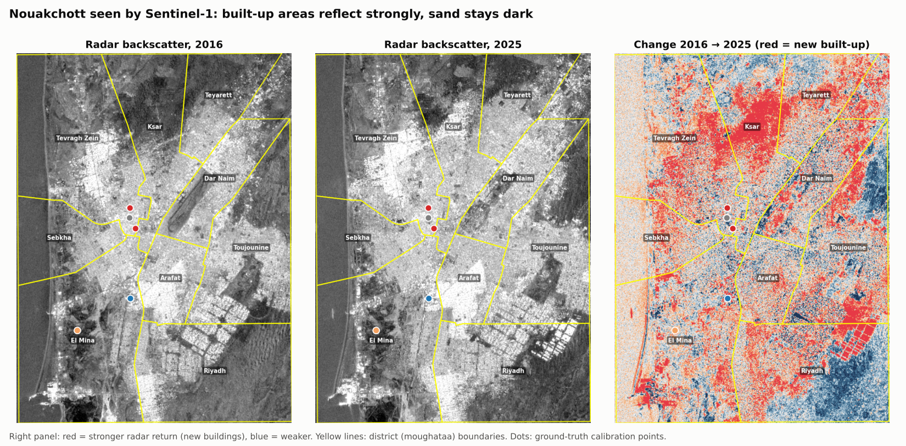
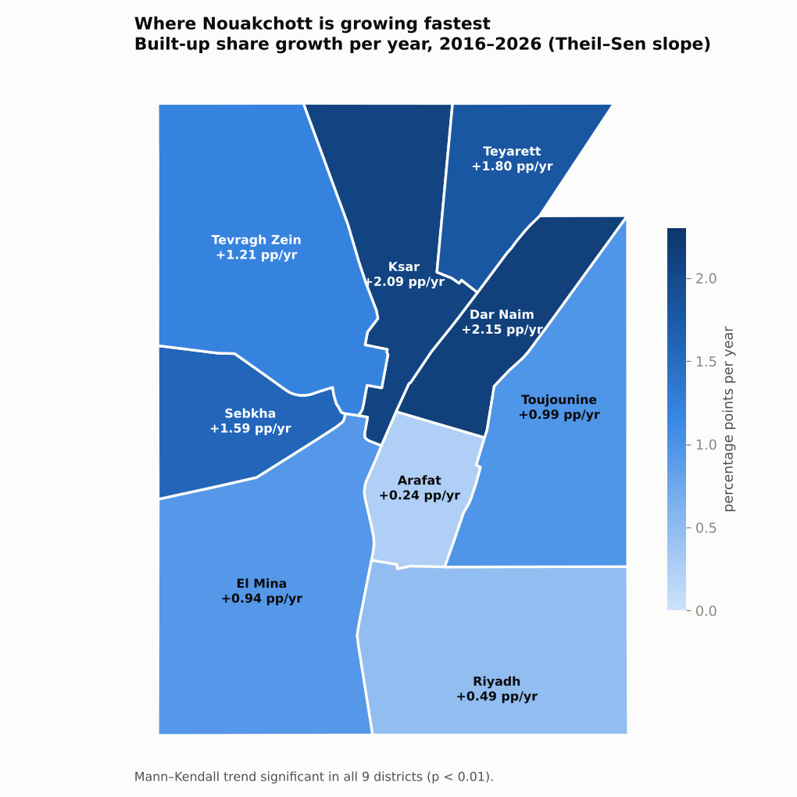
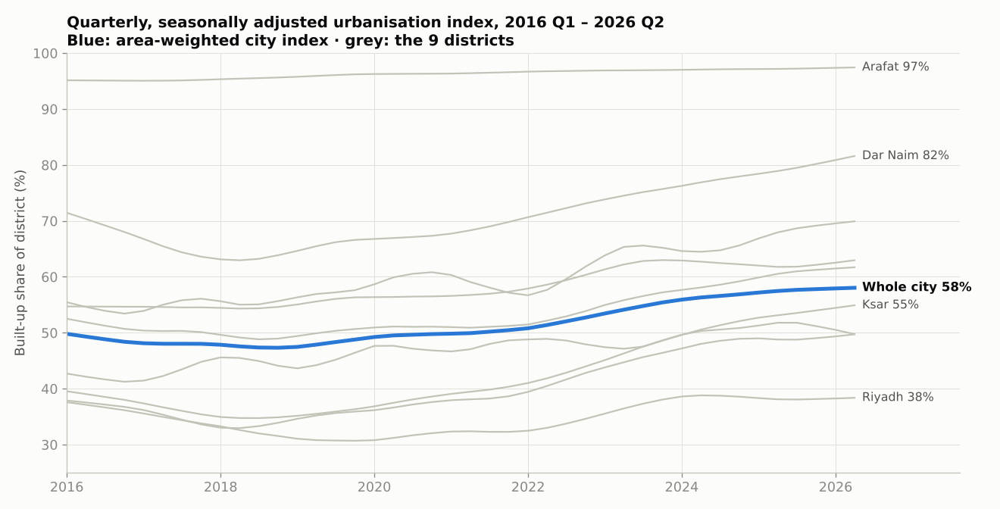
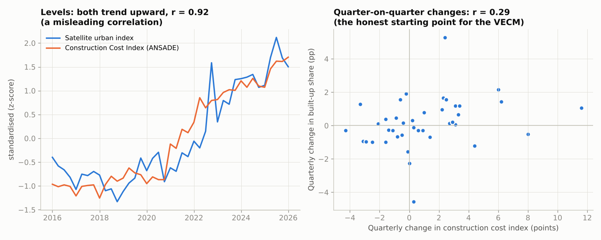

# Measuring Nouakchott's urban growth from satellite radar

**A quarterly, district-level urbanisation index for Mauritania's capital, built from Sentinel-1 radar on Google Earth Engine and validated against official construction statistics.**

Master's thesis in Econometrics and Applied Statistics · University of Nouakchott, in partnership with ANSADE (Mauritania's national statistics agency) · 2026 · grade 17/20



---

## The question

Nouakchott has grown from a small administrative town into a city of more than a million people, but the official statistics on that growth come from a census held once every ten years and published long after.

Satellite imagery could fill the gap, but the standard method fails here. Optical built-up indices such as NDBI cannot separate sand from concrete in the Sahara, because both reflect sunlight in almost the same way. On the test points used in this project, desert sand was classified as built-up.

**So the question was:** can radar, which "sees" buildings rather than colours, measure how much of each district is built up, every quarter, reliably enough to be used as an official statistic?

## Key results

| | Result |
|---|---|
| **Built-up share of the city** | **46.9 % in 2016 → 58.5 % in 2025** (+1.29 percentage points a year, area-weighted) |
| **Trend** | Significant increase in **all 9 districts** (Mann–Kendall, p < 0.01) |
| **Fastest-growing fringes** | Dar Naim **+2.15** pp/yr · Ksar **+2.09** · Teyarett **+1.80** |
| **Saturated core** | Arafat already 95 % built-up in 2016 (+0.24 pp/yr) |
| **Link with the economy** | Construction costs and the built footprint share a long-run equilibrium; **costs lead, the footprint follows** |
| **Timeliness** | The index covers **2026 Q2**; the matching official annual figure will not exist before 2027 |



The map is the practical output for planners: the city is not growing evenly. The northern and eastern fringes (Dar Naim, Ksar, Teyarett) are absorbing most of the new construction, while the centre is full and Riyadh, in the south, is barely moving.

## Approach

1. **Test the obvious method first.** Sentinel-2 optical indices (NDBI, NDWI, BAEI, BU) were measured at six ground-truth points checked on high-resolution imagery: dense urban, pure sand, lagoon and a main road. Sand and concrete overlapped on every index, and optical change detection between 2016 and 2024 also failed. This ruled out the optical approach and justified using radar.
2. **Switch to radar.** Sentinel-1 VV backscatter separates the two cleanly. Walls and the ground form a "double bounce" that sends a strong signal back (about −7 to −10 dB), while smooth sand reflects it away (about −20 dB). The 10–13 dB gap is physical, stable over time, and unaffected by clouds or dust.
3. **Classify and aggregate.** A pixel counts as built-up when VV > −14 dB and it is not water (an NDWI mask removes the coastal sebkha). For each of the 9 districts the pipeline computes the built-up share every year, plus a continuous monthly backscatter series from 274 Sentinel-1 scenes (Jan 2016 – Jun 2026).
4. **Remove seasonality.** Each district's monthly series is decomposed with STL (trend + seasonal + residual), calibrated against the annual built-up share, and resampled to quarters. This gives 42 quarterly points per district instead of 10 annual ones.
5. **Test the trend.** Mann–Kendall for significance and Theil–Sen for the growth rate in each district, plus an area-weighted index for the whole city.
6. **Validate against the economy.** The city index is compared with ANSADE's quarterly Construction Cost Index (ICC), 2016 Q1 – 2026 Q1, n = 41.



## Checking that the relationship is real

The two series move together almost perfectly in levels (r = 0.92). That number is meaningless on its own: any two series that both trend upward will correlate, whether or not one has anything to do with the other.



So the validation follows the standard sequence for trending series:

| Step | Result |
|---|---|
| Unit-root tests (ADF, confirmed by KPSS) | Both series are non-stationary in levels and stationary in first differences: I(1) |
| Engle–Granger cointegration | Cointegrated (p = 0.009) |
| Johansen cointegration | One long-run relationship (rank = 1) |
| VECM, 1 lag (Hannan–Quinn criterion) | Both series adjust back to the long-run equilibrium |
| Granger causality within the VECM | Construction costs → built footprint: **p = 0.011**. Footprint → costs: p = 0.23 (not significant) |

**Interpretation:** the cost index captures the upstream phase of construction (materials, labour), and the satellite sees the result once the buildings stand. The radar index therefore behaves as a lagging but much faster-to-publish indicator of building activity.

## Limitations

- **Short sample.** n = 41 quarters is enough for these tests, but not for strong conclusions. The one-way Granger result holds at 1 to 3 lags; at 4 or more lags, causality appears in both directions.
- **No independent ground survey.** The −14 dB threshold is calibrated on six reference points and published imagery, not on a field survey.
- **Satellite coverage.** Only the ascending orbit covers Nouakchott, and Sentinel-1B failed in December 2021, so there are fewer images per year after that date (about 23 against 30).
- **Two fragile districts.** Riyadh (mixed, scattered land use) has the weakest calibration. Sebkha has the strongest seasonal swing, because of the coastal salt flats.

Before ANSADE could adopt the index officially, it would need an independent ground validation, an automated pipeline, and a published method note.

## Repository structure

```
├── notebooks/
│   └── nouakchott_sar_urbanisation.ipynb   full analysis, Earth Engine → econometrics (in French)
├── data/
│   ├── boundaries/nouakchott_moughataa.geojson   the 9 district boundaries (OCHA / HDX admin-2)
│   └── processed/                               outputs of the notebook, small CSVs
│       ├── sar_urban_fraction_timeseries.csv     annual built-up share by district, 2016–2025
│       ├── monthly_sar_vv.csv                    monthly mean VV backscatter by district + image counts
│       ├── quarterly_uf_stl.csv                  quarterly seasonally adjusted built-up share by district
│       ├── eco_quarterly_tests.csv               city index + Construction Cost Index, quarterly
│       └── district_growth_summary.csv           Theil–Sen slope and Mann–Kendall test by district
├── figures/                                     figures used in this README
├── scripts/make_readme_figures.py               rebuilds the README figures from data/processed
└── requirements.txt
```

## Reproduce

**Figures and statistics (no Earth Engine account needed):**

```bash
pip install -r requirements.txt
python scripts/make_readme_figures.py
```

**Full pipeline from the satellite images:**

```bash
earthengine authenticate            # one-time Google sign-in
export GEE_PROJECT=<your-gcp-project>
cd notebooks && jupyter lab         # run nouakchott_sar_urbanisation.ipynb top to bottom
```

## Data sources

- **Sentinel-1 GRD (radar) and Sentinel-2 SR (optical):** European Space Agency / Copernicus, accessed through Google Earth Engine.
- **Construction Cost Index (ICC), quarterly, base 2012 = 100:** ANSADE.
- **District boundaries:** Mauritania administrative level 2, OCHA Humanitarian Data Exchange.

## Author

**Mohamedou Loughmane**, data analyst · [LinkedIn](https://www.linkedin.com/in/mohamedou-loughmane-38b898282/) · loughmanemohamedou@gmail.com

Supervised by Salem Ould Abeidne (University of Nouakchott) and Dr Mohamed Mahfoudh Hadein (ANSADE).
